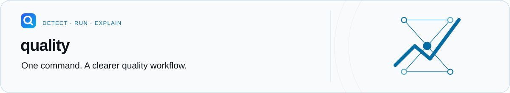

<p align="center">
  <a href="../../README.md">
    <picture>
      <source media="(prefers-color-scheme: dark)" srcset="../../docs/assets/readme/workspace-dark.svg">
      
    </picture>
  </a>
</p>

<h1 align="center">Rust CLI</h1>

<p align="center">Tool discovery, deterministic checks, and normalized diagnostics.</p>

<p align="center">
  <a href="../../LICENSE"></a>
  <a href="package.json"></a>
</p>

**On this page:** [Responsibility](#responsibility) · [Development](#development) · [Resources](#resources)

## Responsibility

This crate builds the `quality` executable. It owns command parsing, adapter execution, and
reporting. The [root README](../../README.md) remains the user installation guide and the
README referenced by the crate manifest.

Use the [CLI playground](../../playground/README.md) to explore checking, formatting, baselines,
changed-file selection, and SARIF with disposable data.

## Development

Use the Rust toolchain declared by the repository. Run from the repository root:

```bash
cargo check --package quality-cli
cargo test --package quality-cli
cargo run --package quality-cli -- --help
```

The canonical `pnpm check` command runs the repository's own Quality configuration. Keep AI
features outside the deterministic checking path, and update the site documentation when a
command or configuration contract changes.

## Resources

[Source](src) · [Crate manifest](Cargo.toml) · [Documentation](../../apps/site/README.md) ·
[GitHub Action](../../packages/action/README.md) · [License](../../LICENSE)
